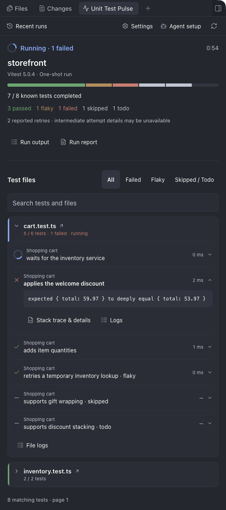
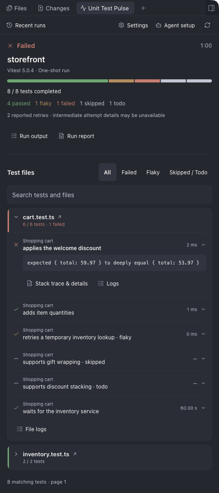
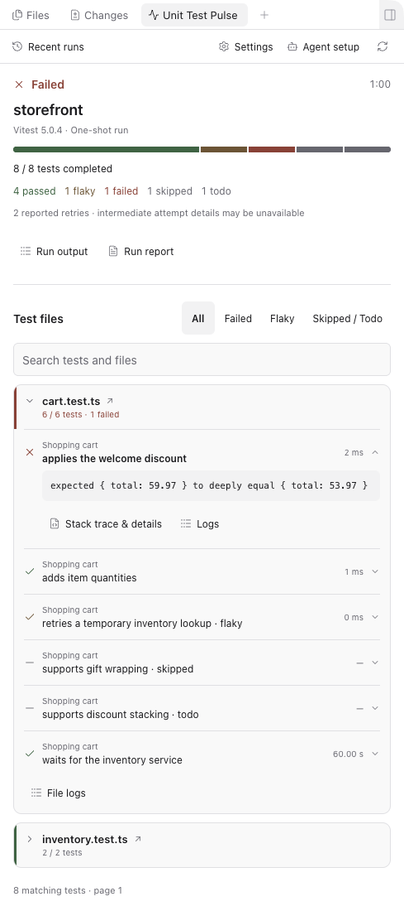
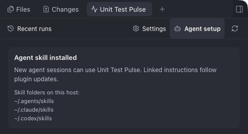
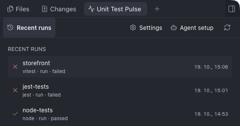
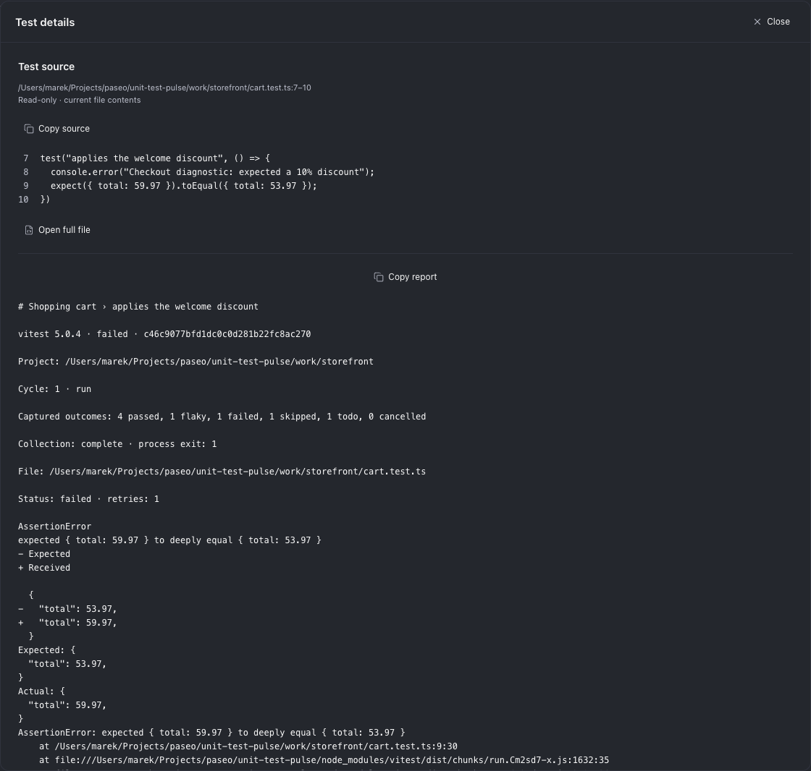
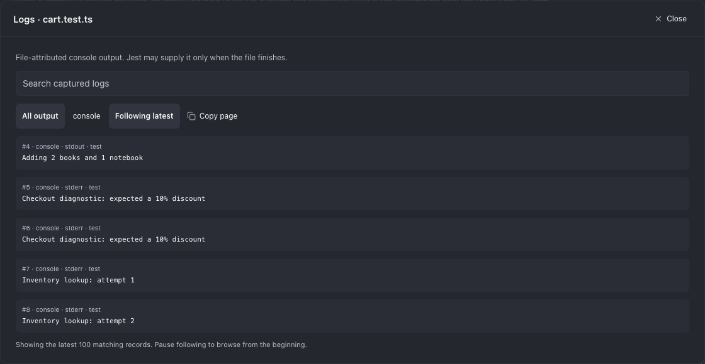
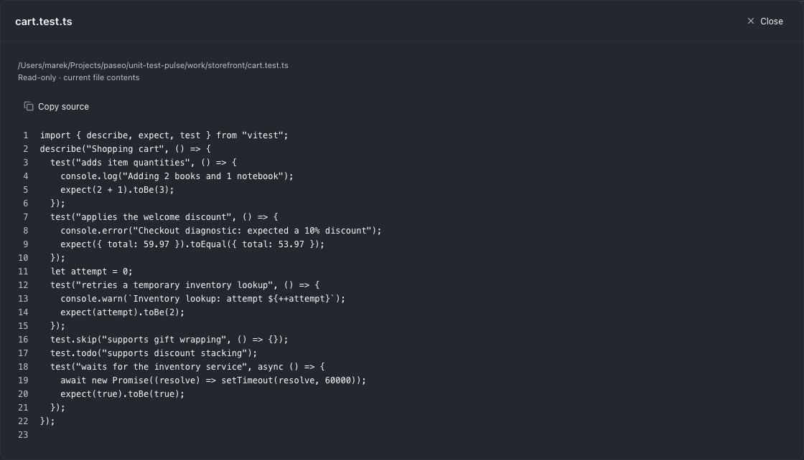
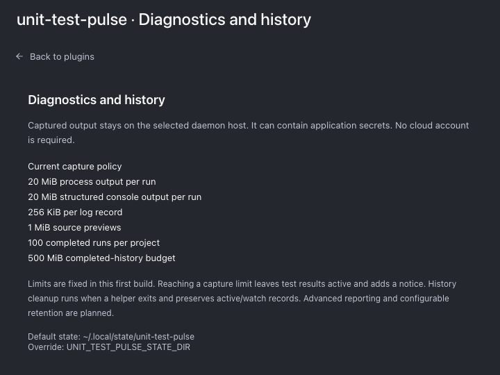

# Unit Test Pulse

Follow JavaScript and TypeScript unit tests in Paseo while an agent works. Inspect live results grouped by test file, assertion failures, stack traces, current source, and captured output from the same panel.

**Status:** early build, version 0.7.0, with live Vitest, Jest, Mocha, Bun, Jasmine, and Node.js test-runner monitoring. Tested versions and current limitations are listed below.

<p>
  
  
</p>

These are real Paseo 0.12.0 desktop captures on macOS, using an isolated storefront example. One assertion deliberately fails and another passes after retrying. Captures are cropped to the plugin panel, preview dialog, or settings content.

<details>
<summary>Light theme example</summary>



</details>

## Get started

Install the local checkout:

```sh
paseo plugin install /absolute/path/to/unit-test-pulse
```

Open **Unit Test Pulse** in a workspace through the Command Center. Choose **Install skill** to make its instructions available to new agent sessions. Existing skill files owned by another installation are left unchanged.

For example: “Use Unit Test Pulse to run the unit tests, preserving this project's usual environment and test selection.”



The plugin installs a local helper on the daemon host:

```sh
node ~/.local/share/unit-test-pulse/cli.mjs doctor --project /absolute/project
node ~/.local/share/unit-test-pulse/cli.mjs run --project /absolute/project --runner vitest -- --testNamePattern 'example'
node ~/.local/share/unit-test-pulse/cli.mjs run --project /absolute/project --runner jest -- --runInBand
node ~/.local/share/unit-test-pulse/cli.mjs run --project /absolute/project --runner mocha -- --grep 'example'
node ~/.local/share/unit-test-pulse/cli.mjs run --project /absolute/project --runner bun -- --test-name-pattern 'example'
node ~/.local/share/unit-test-pulse/cli.mjs run --project /absolute/project --runner jasmine -- --filter=example
node ~/.local/share/unit-test-pulse/cli.mjs run --project /absolute/project --runner node -- --test-name-pattern 'example' tests/example.test.mjs
```

Arguments after `--` belong to the runner, including `--config` for alternate configurations (`--config=path` for Jasmine). For ongoing monitoring, add helper `--watch` before `--`. When the tested package is nested in a Paseo workspace, add `--workspace /absolute/workspace` before `--`.

The helper launches the existing installed runner directly, or the helper's Node.js executable for `--runner node`. Preserve environment variables, loaders, application startup, and prerequisites from the project's usual package scripts. It does not execute those prerequisites or install dependencies in monitored projects. A running command must already be instrumented to publish results; arbitrary uninstrumented processes cannot be attached.

## Node.js built-in tests

Use `--runner node` for tests run with `node --test`, including `node:test` / `node:assert/strict`, `node:assert`, and assertion libraries that throw errors inside Node tests. No test-framework dependency is needed. ESM, CommonJS, `describe()` / `it()`, `test()`, context subtests, callback tests, skip/todo, and assertion-only files executed by Node are supported. TypeScript uses the selected Node runtime's own type stripping or the project's existing loader; monitoring does not add a transpiler.

Put native Node options before file paths, just as with `node --test`. The helper adds `--test` automatically; `--import`, `--require`, `--test-name-pattern`, file selection, concurrency, coverage options, and existing reporters/destinations keep their native meaning. Reporter settings in `NODE_OPTIONS` are also preserved. Use helper `--watch` before `--` for an ongoing watcher. A Node watch cycle records only the files that Node re-executes, so an unchanged file is absent from later cycles.

`doctor` always lists the available built-in runner. If no Vitest, Jest, Mocha, or Jasmine package is installed, an omitted `--runner` selects Node.js. A single installed Vitest, Jest, Mocha, or Jasmine runner remains the default; use an explicit selection when several are installed. Bun requires an explicit `--runner bun` and does not change automatic selection for existing projects.

Node assertion reports keep the original assertion stack and formatted expected/actual values. Output and diagnostics supplied by Node carry file identity, not individual test ownership. Test results follow Node's declaration-ordered reporting, so an earlier slow concurrent test can delay later results. An unmatched name filter is shown as no executed tests, even when Node also reports a successful file wrapper. Separate adapters are still required for AVA, Tape, and other independent runners.

## Mocha tests

Use `--runner mocha` for Mocha 11/12 projects, including suites using Chai, Node assertions, or other assertion libraries. The helper runs the project's native Mocha CLI, adding an external observer alongside its existing reporter. Test sources, configuration, installed packages, reporter options, async reporter completion, preloads, and native exit codes are preserved. `--config`, `--grep`, `--ui`, `--require`, `--node-option`, retries, bail, and parallel execution retain their native meaning. TypeScript requires the runtime's type stripping or the project's existing loader; monitoring does not install one.

Add helper `--watch` before `--` for ongoing monitoring. Each rerun has independent results and an idle state. Without that flag or a native `--watch` / `-w` argument, the helper selects one-shot execution even if the configuration enables watching. Mocha's parallel reporter buffers events until each file completes, so it does not provide immediate test-by-test progress within an active worker file.

Failure reports retain assertion stacks and available expected/actual values; hook and global fixture failures remain visible even when assertions pass. Mocha 11 can exit with code 0 after a global teardown error; the panel still reports the captured error while the helper preserves that native exit code. Final retry counts distinguish flaky passes. Mocha's skipped tests and pending declarations both appear as **Skipped**. Dry runs display **No executed tests**. Source previews support BDD/TDD declarations, `context` / `specify`, and Mocha import aliases. Mocha does not supply declaration locations, so duplicate or generated titles may require opening the full file.

Mocha stdout/stderr is available in **Run output**. Its reporter events do not identify which test owns console output, so the helper does not assign that output to individual tests or files. A private temporary result journal bridges native CLI subprocesses and forced exits; it is removed when the helper stops normally.

## Bun tests

Use `--runner bun` with an existing Bun 1.4.x executable, version 1.4.3 or later. `doctor` searches the project's `node_modules/.bin` and then `PATH`; set `UNIT_TEST_PULSE_BUN_BIN=/absolute/path/to/bun` to select another executable. Monitoring does not install Bun or dependencies in the tested project. Bun runs its native `test` command with its normal configuration, `.env` files, preloads, TypeScript/JSX handling, filters, reporters (including existing JUnit destinations), and exit code.

The observer connects to a private inspector bound to `127.0.0.1` on an automatically allocated port, using a random endpoint. No hosted debugger is contacted. An external preload adds a completion hook that lets the collector drain inspector events before Bun exits; it does not modify project files. Live results come from Bun's structured test events, including suite paths, source locations when available, duplicate titles, retries, skip/todo, timeouts, and concurrent tests in one process. Bun's current `--parallel` workers do not publish these events, so that mode is rejected explicitly. Existing inspector flags and `BUN_INSPECT*` settings, hot reload, and evaluation commands are also rejected; use native Bun for those operations.

Add helper `--watch` before `--` (or native `--watch`) for an ongoing watcher. Cycles and idle states are separate. Bun provides no structured run-end event, so watch completion validates the native summary against structured outcomes after an inspector protocol barrier. Console output that resembles a summary is ignored. Missing results are reported as incomplete instead of a successful complete capture.

**Diagnostics limitation:** Bun does not include a test ID in console or lifecycle error events. Failure messages, assertion diffs, and any supplied stack frames remain at run scope in **Run output**. Per-test details show the result and source declaration and direct you to that output; errors and logs are never assigned to a test by timing. Some assertion errors provide no stack frames. Hook/runtime errors and unsuccessful coverage checks stay visible even when the captured assertions pass. Intermediate retry diagnostics can remain in Run output after a flaky pass.

## Jasmine tests

Use `--runner jasmine` for Jasmine 6/7 projects. The helper launches the project's native Jasmine CLI with an external observer. Configuration, helpers, existing reporters (including async completion), loaders, randomization, seed, file/name filters, global setup/teardown, and native exit behavior are preserved. Monitoring changes no project files or installed dependencies. Use native argument syntax such as `--config=spec/support/jasmine.mjs`, `--filter=example`, `--seed=54321`, and `--parallel=2`. Parallel mode follows Jasmine's normal restrictions, including enabled randomization and no fixed seed.

The panel captures live spec results, assertion messages and stacks, suite/global failures, durations, pending/excluded/not-applicable results, and the random seed when supplied. Jasmine's normal reporter results contain formatted assertion messages rather than separate expected/actual objects. Pending, excluded, and Jasmine 7's not-applicable tests appear as **Skipped**, with their native status retained. Native duplicate-name checks remain enabled; repeated names in different suites or files retain separate identities. Source previews support Jasmine globals and `jasmine-core` aliases; generated or ambiguous declarations may require opening the full file. Declaration filenames depend on Jasmine's own stack inspection, so projects wrapping `it()` / `describe()` should retain their existing `extraItStackFrames` / `extraDescribeStackFrames` settings.

Process stdout/stderr remains in **Run output**. Only `jasmine.debugLog()` records supplied with a spec identity and pending/not-applicable reasons are attached to a test; Jasmine normally emits debug logs for failing specs. The helper never guesses console ownership from execution timing. A private temporary result journal preserves final events across Jasmine's explicit process exit and is removed on normal helper shutdown.

Jasmine has no native watch mode, so helper/native `--watch` is rejected. Focused suites retain Jasmine's incomplete status notice and nonzero exit. Empty selections, skip-only runs, timeouts, reporter errors, loader failures, and unsuccessful process exits are never presented as successful assertion verification. Jasmine has no native retries to report.

## Dashboard and diagnostics

- Recent runs keeps independent executions and watch cycles separate. A watch session displays **Watching — idle** after each cycle. Use **Follow latest run** to leave a manually selected historical result.
- The summary distinguishes clean passes, passes after retry, failures, skipped tests, todo tests, and cancellation. Test counts remain **known** until collection finishes. No-test and skip/todo-only cycles display **No executed tests**.
- File cards preserve full counts while filters and search narrow the displayed tests. Details are paged in groups of 200; select a file to browse its tests. The panel lists 30 recent runs; the helper can list all retained runs.
- Expand a test for its failure message, **Stack trace & details**, and **Logs**. Reports include captured errors, available diffs, runner/project identity, retry information, and an output excerpt. **Run report** also lists the slowest captured test durations.
- **Test details** shows the selected `it()` / `test()` declaration above its report, with original line numbers, **Copy source**, and **Open full file**. Nested suites, standard modifiers, aliases imported from Vitest/Jest/Mocha/Bun/Jasmine/Node, CommonJS Mocha/Bun/Jasmine/Node aliases, context subtests, and parameterized tests with runner locations are supported. Older runs use an unambiguous title-path match. Generated/custom declarations that cannot be matched show an explanation and full-file access.
- Click a filename for a read-only preview of its current contents with line numbers. The file may have changed since execution. Source reads are restricted to files reported by the run, within the selected workspace, up to 1 MiB.
- **Run output** contains stdout/stderr plus separately captured console records. Log views support text search, stream filters, following the latest 100 records, pausing to browse pages, and copying a page.
- The workspace header indicates active runs and recent outcomes even when the panel is closed.

<details>
<summary>Recent runs across test runners</summary>



</details>

<details>
<summary>Test details and captured logs</summary>




</details>

<details>
<summary>Full test file source preview</summary>



</details>

Console records carry only identities provided by the runner. Vitest can supply test-attributed output. Jest console buffers, when supplied, are file-scoped and may arrive at file completion; Node.js stdout/stderr and diagnostics supplied by the runner are file-scoped. Unassigned process stdout/stderr remains run-scoped. Silent mode and custom environments can suppress console records. Empty test logs do not establish that a test produced no process output. The separate capture views can contain repeated text.

Retry counts and final errors are preserved when provided. Intermediate attempt details may be unavailable. A failing coverage threshold, configuration, import, teardown, or runner process must remain visible even when reported assertions passed.

## Compatibility

| Component            | Integration target       | Verified locally           |
| -------------------- | ------------------------ | -------------------------- |
| Paseo app and daemon | `>=0.11.2 <0.13.0`       | 0.11.2 and 0.12.0 on macOS |
| Helper Node.js       | `^22.18.0` or `^24.0.0`  | 24.16.0                    |
| Vitest               | 4.x and 5.x              | 4.1.11 and 5.0.4           |
| Jest                 | 30.x                     | 30.5.2                     |
| Mocha                | 11.x and 12.x            | 11.8.0 and 12.0.3          |
| Bun                  | 1.4.x, starting at 1.4.3 | 1.4.3                      |
| Jasmine              | 6.x and 7.x              | 6.3.0 and 7.0.0            |
| Node.js test runner  | 22.18+ and 24.x          | 22.18.0 and 24.16.0        |

Vitest 4.1.11 and 5.0.4 contain a task-update timer edge case that can leave completed tests queued until another event or file completion. For the recognized affected implementation, the helper adds a worker preload that repairs only that timer in memory. Project files and installed dependencies are not edited; existing worker preloads are preserved. Unknown or already-fixed implementations are left unchanged. Vitest's VM module cache is bridged into the same scoped repair. Regression checks cover exact timer boundaries in fork, thread, and VM pools.

The plugin typechecks against the Paseo 0.12.0 SDK and loads in the 0.12.0 daemon. The screenshot set verifies the live desktop panel, recent runs, source and diagnostic dialogs, logs, agent setup, settings, and Ghostty/Light themes on 0.12.0.

The helper rejects other runner majors. Other releases within these majors are integration targets, not separately verified compatibility claims. Vitest 4 is installed in an isolated development fixture to avoid mixing incompatible optional peers with Vitest 5.

Real-runner checks cover partial results, assertion errors, test logs, retries, skip/todo, native-versus-monitored reporter/configuration behavior, watch reruns, startup errors, concurrent commands, and interruption. The unit and real-runner integration checks passed with Node 22.18.0 and 24.16.0. The live Paseo dark-theme panel was checked at approximately 320 px, including stack/diff reports, test logs, source previews, and filtering. Ghostty and Light theme desktop captures are included above. Native mobile visual checks remain pending.

Node integration checks also cover ESM/CommonJS/TypeScript and assertion-only files without project dependencies, native reporter destinations and preloads, nested and duplicate titles, strict assertion values, source selection, watch cycles, interruption, timeouts, cancellation, and empty selections.

Mocha integration checks cover both majors: gated live results, strict assertion details, retries, skipped/pending tests, duplicate titles, source selection, ESM/CommonJS/TypeScript, TDD aliases, unchanged native configuration and reporters, Node-flag subprocesses, forced exit, hook failures, parallel results, watch reruns, concurrent commands, interruption, dry runs, bail, empty selections, and startup errors. Additional regressions cover exhausted retries, zero native failure exit codes, reporter/global-teardown failures, large Unicode records, and flushing queued IPC results before disconnect.

Bun integration checks cover live results, duplicate/parameterized/dynamic titles, native configuration, preloads and environment files, JUnit output, CommonJS/TypeScript/TSX, aliases, retries, skip/todo, timeouts, concurrent tests, watch cycles and teardown recovery, interruption, repeat runs, empty selections, startup and coverage errors, runtime discovery, and explicit rejection of unobservable parallel workers. Watch checks include console output resembling a native summary. Repeated runs with large Unicode final events guard against Bun exiting before its inspector flushes; bail and explicit process-exit checks preserve native exit codes.

Jasmine integration checks cover both majors: gated live progress, assertion stacks, debug-log ownership, skipped and focused specs, duplicate titles, nested parallel results and worker identity reuse, source previews, async/callback timeouts, native configuration/helpers/reporters, environment-selected configuration, Node preloads, random seeds, filters, startup/global/suite/reporter failures, concurrent commands, interruption, empty selections, explicit exits, and large Unicode final events. TypeScript and CommonJS `jasmine-core` aliases and Jasmine 7's not-applicable results are also checked.

The compatibility suite also checks duplicate and parameterized titles, per-test source selection, a nested Jest configuration with a preset reporter, custom environment and TypeScript transform, and a Jest coverage-threshold failure. Source extraction checks cover nested suites, imported aliases, modifiers, JSX, original line numbers, ambiguous declarations, and workspace boundaries.

Browser-mode tests, multi-project configurations, configuration-file changes during watching, different operating systems, and native mobile clients need additional verification. The client follows Paseo's cross-platform component rules, but that alone is not a mobile compatibility test.

## Local data and limits

Open **Settings** in the panel to inspect the current diagnostics and history policy. These limits are informational and fixed in this build.

<details>
<summary>Diagnostics and history settings</summary>



</details>

Results and captured output stay under `~/.local/state/unit-test-pulse` on the daemon host. Use `UNIT_TEST_PULSE_STATE_DIR` or helper `--state-dir PATH` to override it; helper and daemon must share the same location. Helper runtime files live under `~/.local/share/unit-test-pulse`.

Process output and structured console logs each have a 20 MiB capture budget per cycle, including serialized record overhead. Individual log records are limited to 256 KiB. Console collection also drops records with a visible notice if its communication queue is overloaded. Result collection continues after output capture stops. Log reads have a 64 MiB bound and result/source/report reads have their own explicit limits.

Runs whose project or worktree folder has been removed are omitted from workspace history without generating warnings. Their saved results are retained under the normal history policy. Missing records during cleanup are also skipped; damaged records and unexpected read errors still produce notices.

Completed history is cleaned up on cycle rollover and helper exit, keeping the latest 100 cycles per project within a 500 MiB completed-history budget where possible. Active and idle-watch records are preserved. This first build does not impose a hard global budget on all simultaneous active runs. Capture and retention settings are informational and fixed for now.

Captured logs can contain application secrets. The plugin does not record the full environment and does not claim automatic secret removal. Copy and export actions use captured text; no cloud service or extra account is required.

For agent-readable results:

```sh
node ~/.local/share/unit-test-pulse/cli.mjs list --project /absolute/project
node ~/.local/share/unit-test-pulse/cli.mjs show --project /absolute/project --run-id ID
node ~/.local/share/unit-test-pulse/cli.mjs logs --project /absolute/project --run-id ID --test-id TEST_ID
```

Log reads return `next` when another page exists; pass it as `--cursor N`. `--search TEXT` filters captured output. Keep the explicit run ID when several commands run concurrently.

## Development

```sh
npm ci --ignore-scripts
npm run setup:compat
npm run check
npm run test:integration
paseo plugin reload unit-test-pulse
```

[GitHub Actions](.github/workflows/check.yml) runs type checking, all unit tests, and the complete real-runner integration suite on Node 22.18.0 and 24.x for pushes, pull requests, and manual runs. After dependencies and compatibility runtimes are prepared, both test suites run even if an earlier check fails; each Node version completes independently.

Live-progress integration checks hold a fixture test open until the observer has read persisted partial results. Delayed observation and staggered command startup exercise the former timing race without requiring a short overlap window. Polling stops when a runner exits unexpectedly and includes its output and the last snapshots in failures. Child processes are stopped before temporary fixture data is removed.

The [adapter examples](examples/README.md) cover Vitest, Jest, Mocha, Bun, Jasmine, and Node.js. Each project includes a cart suite with an intentional assertion failure and a separate passing pricing suite, plus logs, skips, async progress, and retries/todo where supported. Run either the native test script or its monitored equivalent from the repository root:

```sh
npm --prefix examples/jest test
npm --prefix examples/jest run test:pulse
```

Replace `jest` with the desired example folder. Full demos intentionally exit unsuccessfully; the examples guide lists expected outcomes, native differences, and how to select a passing file. All examples use the repository's development dependencies.

The runtime helper uses Node's standard library, a bundled `ws` client for Bun's local inspector, and the monitored project's installed runner or selected Bun executable. The helper installer copies its WebSocket dependency into the managed runtime; consumers do not install it in their projects. Paseo provides the panel's runtime libraries. The plugin uses TypeScript as a runtime dependency to parse test declarations for source previews without executing the source. Test runners and SDK tooling are development dependencies.

Advanced historical comparisons, failure grouping, coverage summaries, report imports, configurable retention, and adapters for other runners are not implemented yet.

Known reporting issues before 1.0: a clean Jest run can be labelled **Failed** in the summary even when every captured test passes and the process exits successfully. Its test counts and exit code remain accurate. The reporter currently reads Jest’s aggregate success flag before Jest finalizes it; this requires a separate fix that also preserves coverage and custom-reporter failures. Jest retries can also create duplicate captured test entries because retry events currently receive new occurrence identities. The Jest example uses single attempts until that identity handling is corrected.

Based on the design and selected utility components of [Cypress Pulse](https://github.com/mbranicky/cypress-pulse), with its MIT attribution preserved. [MIT license](LICENSE).
